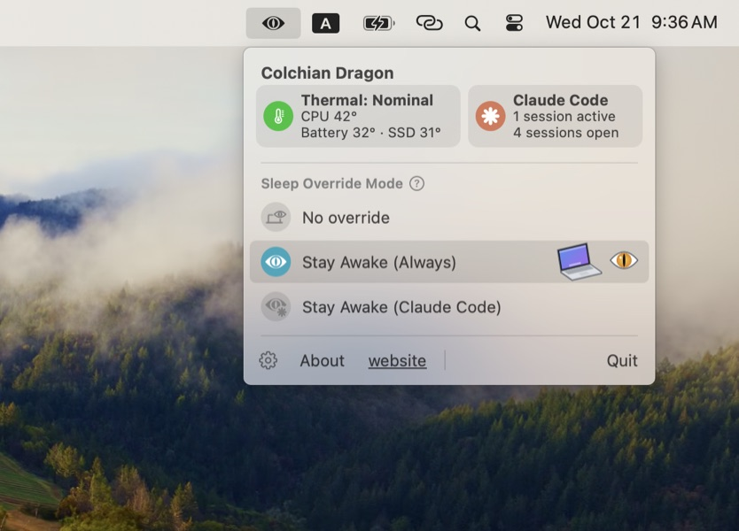

# Colchian Dragon

Colchian Dragon is a macOS menu bar app that keeps your MacBook awake with the lid closed, so you can close the laptop without interrupting a running [Claude Code](https://claude.com/claude-code) session or other running tasks.

  &nbsp;&nbsp;&nbsp;
  

## How to use the app

Choose one of three modes from the menu bar:

- **No override:** the Mac sleeps normally when the lid closes.
- **Stay Awake (Always):** the Mac stays awake with the lid closed.
- **Stay Awake (Claude Code):** the Mac stays awake only while a Claude Code session is working, and goes to sleep when it's done.

If the Mac gets too hot, Colchian Dragon lets it sleep until it cools down.

Requires macOS 13 or later.

## Installation and setup

Download `Colchian-Dragon.zip` from [Releases](https://github.com/danromik/colchian-dragon/releases), unzip it, move `Colchian Dragon.app` to `/Applications` and open it. The app's menu item will appear in the menu bar.

Keeping the Mac awake with the lid closed requires administrator permissions, so the first time you select a Stay Awake mode, Colchian Dragon will ask for your password. You only need to enter it once.

When you select the **Stay Awake (Claude Code)** for the first time, the app will ask to add hooks to Claude Code's `settings.json`. This is needed to let the app track when a Claude Code session is working.

Click the Settings icon for additional customization options.

## Uninstall

In Settings, turn off the Claude Code hooks, remove passwordless control and turn off launch at login if you have it enabled. Then quit Colchian Dragon, delete the app and delete `~/Library/Application Support/Colchian`. The [guide](docs/guide.md#uninstall) also explains how to remove the backup of your Claude Code settings and the app's preferences.

## More

The [guide](docs/guide.md) explains in detail how everything works, how to build from source, and some caveats.

## License

Colchian Dragon is released under the [MIT License](LICENSE).
